  

<h1 align="center">Hi 👋, I'm Md. Soliman Sikder</h1>

<h3 align="center">
  💻 Full Stack Developer | Web Developer
</h3>

  

  

  
  

---

## 👨‍💻 About Me

I'm **Md. Soliman Sikder**, a passionate Web Developer from Dhaka, Bangladesh, interested in building modern, responsive, and full-stack web applications.

I enjoy turning ideas into practical digital solutions — from designing intuitive user interfaces to developing APIs, working with databases, and deploying web applications.

I'm continuously expanding my knowledge of frontend and backend technologies while building real-world projects to strengthen my software development skills.

- 💻 Interested in **Full Stack Web Development**
- ⚛️ Building modern interfaces with React and Next.js
- 🔧 Exploring backend development with Node.js and Express
- 🗄️ Learning to design and work with databases
- 🔐 Exploring authentication, API integration, and application security
- 🚀 Practicing deployment and modern development workflows
- 🌱 Continuously learning, building, and improving

---

## 🛠️ Technology Stack

### 💻 Languages

  

### 🎨 Frontend Development

  

  <strong>Also exploring:</strong> DaisyUI, responsive design, component-based architecture, and modern UI development.

### ⚙️ Backend Development

  

  <strong>Focus areas:</strong> Server-side development, REST APIs, routing, validation, authentication, and backend application architecture.

### 🗄️ Databases & Services

  

  <strong>Focus areas:</strong> CRUD operations, data modeling, database integration, and authentication services.

### 🔧 Tools & Deployment

  

- Git and GitHub for version control
- Vercel for web application deployment
- REST API integration
- Environment variables and application configuration

---

## 🌱 Currently Learning

  

  <strong>Full Stack Web Development</strong>

  Expanding my frontend knowledge into backend development, database management, authentication, API design, and production deployment.

---

# 🚀 Featured Projects

## 🏥 1. MediCare — Hospital Management Dashboard

A modern healthcare management dashboard designed to organize hospital operations through a unified interface.

### ✨ Highlights

- Patient, doctor, and appointment management interfaces
- Consultation and scheduling workflows
- Laboratory and pharmacy inventory modules
- Billing, financial reports, and interactive charts
- Responsive layout with light and dark themes

### 🛠️ Tech Stack

`Next.js` `React` `TypeScript` `Tailwind CSS` `shadcn/ui` `Recharts`

### 🔗 Links

🌐 **Live Demo:** [Medical Management](https://medical-managment-seven.vercel.app/)

💻 **Source Code:** [GitHub Repository](https://github.com/mdsolimansikder7/Medical-managment)

---

## 🖥️ 2. Boss Lab — JS Console

An interactive JavaScript console project created for practicing JavaScript concepts and experimenting with code in a browser-based interface.

### ✨ Highlights

- Interactive JavaScript console
- Practice JavaScript concepts
- Simple and accessible interface
- Browser-based coding experience

### 🛠️ Tech Stack

`HTML` `CSS` `JavaScript`

### 🔗 Links

🌐 **Live Demo:** [Boss Lab — JS Console](https://boss-lab-js-console.vercel.app/)

💻 **Source Code:** [GitHub Repository](https://github.com/mdsolimansikder7/Boss-Lab--JS-Console)

---

## 📰 3. News Orbit

A Bengali-language news website built with Next.js, providing an organized and accessible experience for browsing news and categories.

### ✨ Highlights

- Bengali-language news content
- Organized news sections and categories
- API-based news integration
- Responsive interface
- Clean and readable typography

### 🛠️ Tech Stack

`Next.js` `React` `JavaScript` `CSS` `REST API`

### 🔗 Links

🌐 **Live Demo:** [News Orbit](https://newsorbit-nu.vercel.app/)

💻 **Source Code:** [GitHub Repository](https://github.com/mdsolimansikder7/News-Orbit)

---

## 📅 4. SU Calendar Sync

A university routine and calendar synchronization web application designed for Sonargaon University students.

The project helps students organize academic schedules, import class routines, and export calendar events.

### ✨ Highlights

- Routine image import using OCR
- CSV and JSON routine support
- Weekly class schedule management
- Calendar export using `.ics`
- Browser notification support
- Responsive design

### 🛠️ Tech Stack

`Next.js` `React` `JavaScript` `CSS` `Node.js` `Tesseract OCR` `iCalendar`

### 🔗 Links

🌐 **Live Demo:** [SU Calendar Sync](https://su-calender-sync.vercel.app/)

💻 **Source Code:** [GitHub Repository](https://github.com/mdsolimansikder7/SU-Calender-Sync)

💡 **Inspired by:** [DIU Calendar Sync](https://github.com/6ayzid/diu-calendar-sync)

---

## 📊 GitHub Contributions

  

---

## 📈 GitHub Statistics

  
  

---

## 🔥 GitHub Streak

  

---

## 💻 Coding Profiles

  
  
  

---

## 🎯 Career Goals

My goal is to become a skilled **Full Stack Developer** who can build reliable, scalable, and user-focused web applications.

I'm working toward improving my skills in:

- Full-stack application architecture
- Backend development and REST API design
- Database design and management
- Authentication and application security
- Testing, deployment, and performance optimization
- Open-source collaboration and software engineering practices

I believe in learning by building, improving through feedback, and consistently working toward better solutions.

---

## 🌐 Connect With Me

  
  &nbsp;&nbsp;
  
  &nbsp;&nbsp;
  

  <a href="https://github.com/mdsolimansikder7">GitHub</a>
  &nbsp; • &nbsp;
  <a href="https://www.linkedin.com/in/md-soliman-sikder-b17887237/">LinkedIn</a>
  &nbsp; • &nbsp;
  <a href="mailto:mdsolimansikder62@gmail.com">Email</a>

📧 **Email:** mdsolimansikder62@gmail.com

📍 **Location:** Dhaka, Bangladesh

---

<h3 align="center">
  🚀 Learn • Build • Improve • Grow
</h3>

  Thanks for visiting my profile! If you like my work, feel free to explore my repositories and connect with me. ⭐

